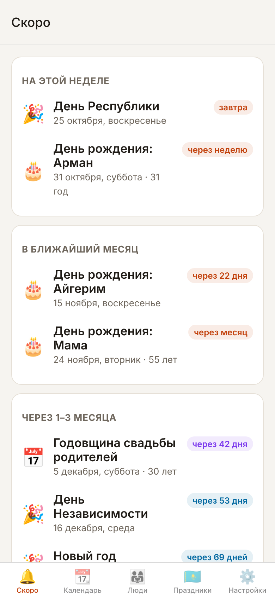
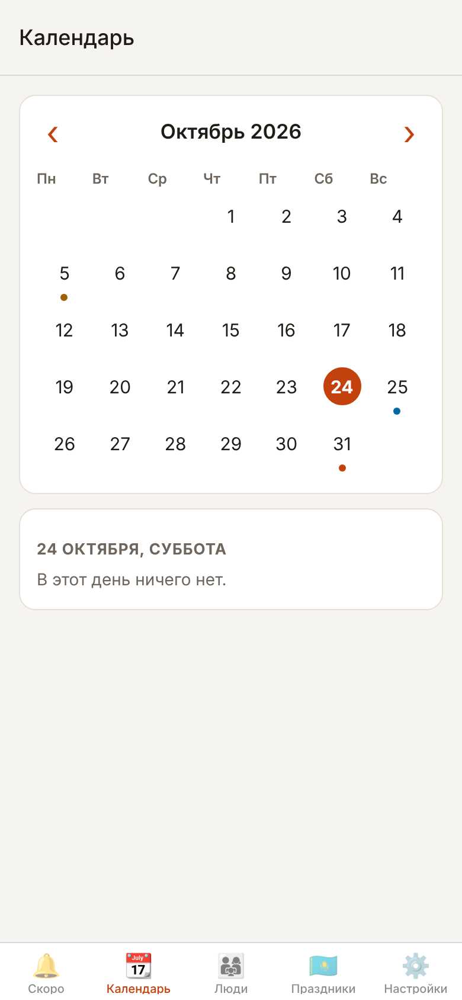

# Calendar

Простое приложение для телефона: заранее напоминает о днях рождения близких и о праздниках Казахстана.

| Ближайшие события | Календарь |
|---|---|
|  |  |

## Установка на iPhone

На iPhone Calendar работает внутри бесплатного приложения Expo Go.

1. Установите [Expo Go](https://apps.apple.com/app/expo-go/id982107779) из App Store.
2. Откройте страницу [Calendar для iPhone](../../releases/tag/iphone) и наведите камеру iPhone на QR-код. Calendar откроется в Expo Go.
3. Разрешите уведомления.

Дальше Calendar будет в Expo Go в списке недавно открытых, обновления подтягиваются сами.

Чтобы эта страница появилась, владельцу репозитория нужно один раз:

1. Зарегистрироваться на [expo.dev](https://expo.dev/signup) (бесплатно).
2. Создать токен: **Account settings → Access tokens → Create token**.
3. Добавить его в репозиторий: **Settings → Secrets and variables → Actions → New repository secret**, имя `EXPO_TOKEN`.
4. Запустить публикацию: **Actions → «Публикация для iPhone» → Run workflow**. Дальше она будет запускаться сама при каждом изменении приложения.

## Установка на Android

1. Откройте на телефоне страницу [последней сборки](../../releases/tag/apk).
2. Скачайте файл `calendar.apk` и откройте его.
3. Телефон спросит, можно ли устанавливать приложения из браузера, — разрешите.
4. При первом запуске разрешите уведомления.

Новые версии ставятся так же, поверх старой; добавленные люди сохраняются.

APK собирается автоматически на GitHub при каждом изменении приложения (вкладка Actions → «Сборка APK»).

## Что умеет

- **Напоминает по близости человека.** Семье — за месяц, неделю, день и в сам день; близким друзьям — за 2 недели и 3 дня; друзьям — за неделю; коллегам — за 3 дня. Меняется в «Настройках».
- **Праздники Казахстана:** государственные, религиозные (Ораза айт, Курбан айт, Рождество) и профессиональные (День учителя, медика, полиции и др.).
- **Профессиональный праздник можно привязать к человеку:** отметьте у сестры «День учителя» — в этот день придёт «Поздравьте: Айгерим».
- **Свои даты:** годовщины свадьбы и т.п.
- Работает без интернета, все данные хранятся только на телефоне.

## Хорошо знать

- Даты Ораза айта и Курбан айта зависят от лунного календаря (внесены по 2030 год), а перечень профессиональных праздников иногда меняется. Список — в `app/src/data/holidaysKz.ts`.
- Приложение заранее ставит 60 ближайших напоминаний и обновляет их при каждом открытии. Открывайте его хотя бы раз в пару месяцев.
- Когда выходит новая версия Expo Go под новый Expo SDK, приложение нужно обновить до этого SDK, иначе Expo Go перестанет его открывать.

## Идеи и ошибки

Пишите в [задачи](../../issues/new/choose) по шаблону «💡 Идея» или «🐞 Что-то не работает».

В задаче можно позвать Claude, написав `@claude`: он ответит или предложит изменения. Для этого в репозитории нужен секрет `ANTHROPIC_API_KEY` (Settings → Secrets and variables → Actions), а позвать его могут только участники с правом записи.

## Для разработки

```bash
cd app
npm install
npm test && npm run typecheck
npx expo start      # открыть на телефоне через Expo Go
```
