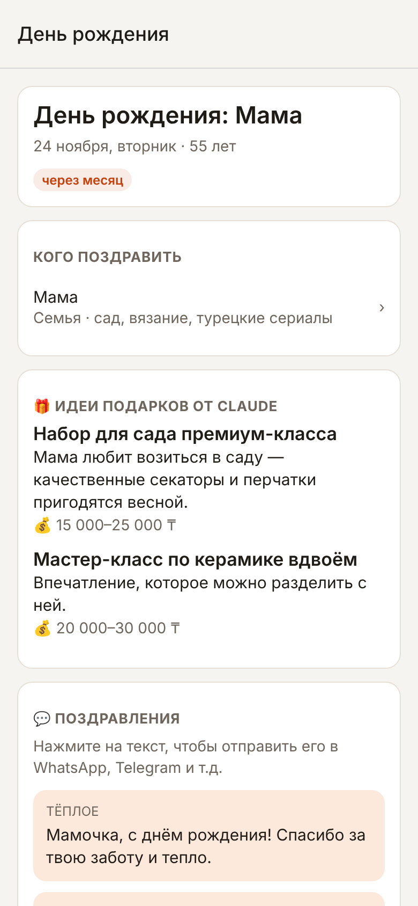

# Не забудь поздравить

Мобильный календарь-помощник: заранее напоминает о днях рождения близких, о государственных и профессиональных праздниках Казахстана, а при напоминании Claude (Anthropic API) предлагает идеи подарков и пишет поздравления.

| Ближайшие события | Идеи от Claude | Календарь |
|---|---|---|
|  |  |  |

## Что умеет

- **Напоминания по близости человека.** По умолчанию семье — за месяц, неделю, день и в сам день; близким друзьям — за 2 недели и 3 дня; друзьям — за неделю; коллегам — за 3 дня. Всё меняется в «Настройках».
- **Праздники Казахстана:** государственные (День Республики, Наурыз, День Независимости…), религиозные (Ораза айт, Курбан айт, Рождество) и профессиональные (День учителя, медика, полиции, строителя и др.).
- **Профессиональные праздники привязываются к людям.** Отметьте у сестры «День учителя», и в этот день придёт напоминание «Поздравьте: Айгерим».
- **Свои даты:** годовщины свадьбы и т.п., с подсчётом «какая по счёту».
- **Идеи от Claude.** Нажали на уведомление — открывается повод, и Claude сразу предлагает 4–6 подарков с ценами в тенге, 2–3 варианта поздравления (по-русски или на казахском) и советы. Поздравление можно сразу отправить в WhatsApp/Telegram. «Ещё идеи» даёт новые варианты без повторов.
- Данные хранятся только на телефоне. На сервер уходит лишь то, что нужно для идей: имя, степень близости, возраст, интересы и заметки о человеке.

## Как устроено

```
app/     Мобильное приложение (Expo / React Native, iOS и Android)
         ├─ напоминания — локальные уведомления телефона, работают без интернета
         └─ «Идеи» → POST /v1/ideas на ваш сервер
server/  Небольшой сервер (Node.js + Hono): хранит ключ Anthropic и вызывает Claude
```

Ключ Anthropic API нельзя класть в приложение — его можно извлечь из сборки. Поэтому приложение ходит на свой сервер, а сервер — в Claude. Сервер принимает запросы только с общим токеном `APP_TOKEN` и ограничивает их число в час (`HOURLY_LIMIT`, по умолчанию 60), чтобы утёкший токен не опустошил счёт.

## Запуск

### 1. Сервер идей

Нужны Node.js 20+ и ключ Anthropic API ([platform.claude.com](https://platform.claude.com/settings/keys)).

```bash
cd server
npm install
cp .env.example .env      # впишите ANTHROPIC_API_KEY и APP_TOKEN (openssl rand -hex 24)
npm run dev               # http://localhost:8787/health
```

Для постоянной работы разверните его на любом хостинге с Docker (Render, Railway, Fly.io, VPS):

```bash
docker build -t birthday-ideas ./server
docker run -p 8787:8787 -e ANTHROPIC_API_KEY=... -e APP_TOKEN=... birthday-ideas
```

Модель по умолчанию — `claude-opus-5-5`; другую можно задать переменной `CLAUDE_MODEL`. Если Claude откажется отвечать по соображениям безопасности, запрос автоматически повторяется на запасной модели (server-side fallback).

### 2. Приложение

```bash
cd app
npm install
cp .env.example .env      # EXPO_PUBLIC_API_URL — адрес сервера, EXPO_PUBLIC_APP_TOKEN — тот же APP_TOKEN
npx expo start            # отсканируйте QR-код приложением Expo Go
```

При локальной разработке в `EXPO_PUBLIC_API_URL` указывайте IP компьютера в сети (`http://192.168.x.x:8787`), а не `localhost` — телефон должен до него достучаться.

Чтобы поставить приложение брату как обычное, соберите его через EAS:

```bash
npx eas-cli@latest build --platform android --profile preview   # APK для Android
npx eas-cli@latest build --platform ios                          # iOS (нужен Apple Developer)
```

Переменные `EXPO_PUBLIC_*` встраиваются в сборку, поэтому задайте их до сборки (в `.env` или в EAS Secrets).

## Настройка под себя

- **Сроки напоминаний и время уведомлений** — экран «Настройки».
- **Какие праздники включены** — экран «Праздники». Профессиональные выключены, пока к ним не привязан человек.
- **Список праздников** — `app/src/data/holidaysKz.ts`. Перечень профессиональных праздников РК меняется приказами Минтруда, а даты Ораза айта и Курбан айта зависят от лунного календаря (внесены по 2030 год; на 2026 — по объявлению ДУМК, дальше — расчётные). Раз в год стоит сверять с egov.kz.
- **Что и как пишет Claude** — системный промпт в `server/src/prompt.ts`.

## Ограничения

- iOS хранит не больше 64 запланированных уведомлений, поэтому приложение планирует 60 ближайших и пересчитывает их при каждом открытии. Если не открывать приложение несколько месяцев, далёкие напоминания не придут, пока его не откроют.
- Идеи требуют интернета и работающего сервера; сами напоминания работают и без них.
- Один запрос идей стоит порядка нескольких центов (зависит от модели). Готовые идеи кэшируются на телефоне, повторное открытие повода запрос не тратит.

## Как предложить идею

Есть идея или что-то не работает — откройте [задачу](../../issues/new/choose) по шаблону «💡 Идея» или «🐞 Что-то не работает». Писать можно обычными словами.

В задаче можно позвать Claude: напишите в комментарии `@claude` и что нужно, например «@claude, как лучше это сделать?» или «@claude, сделай это». Claude ответит в задаче или откроет пулл-реквест с изменениями, а владелец проверит его и примет. Звать Claude могут только участники с правом записи. Чужие люди в публичном репозитории тратить ключ не смогут.

Настройка для владельца репозитория (один раз):

1. **Settings → Collaborators → Add people** — добавить участника по логину GitHub с ролью *Write*.
2. **Settings → Secrets and variables → Actions → New repository secret** — `ANTHROPIC_API_KEY` (можно тот же ключ, что и у сервера; запросы оплачиваются с него).
3. Должно быть установлено приложение [Claude для GitHub](https://github.com/apps/claude).

Если участник хочет работать с кодом вместе с Claude напрямую, он может открыть этот репозиторий в [Claude Code](https://claude.ai/code) со своим аккаунтом Claude. Подсказки для Claude о проекте лежат в `CLAUDE.md`.

## Проверки

```bash
cd app && npm test && npm run typecheck      # расчёт дат, праздников и напоминаний
cd server && npm test && npm run typecheck   # API, промпт, формат запроса к Claude
```
